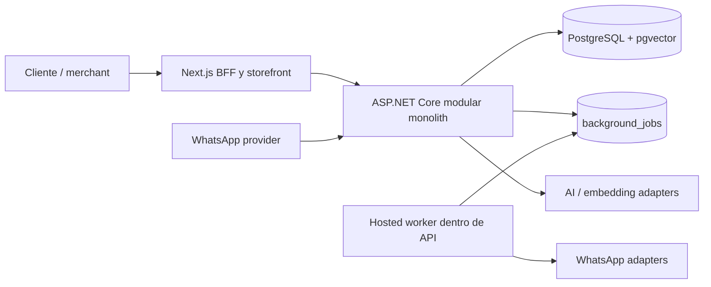

# Arquitectura

**Estado verificado en repositorio:** 27 de septiembre de 2026. Diseño actual: modular monolith; no hay microservicios ni entorno cloud desplegado.

## Vista de contexto



## Módulos actuales

Identity, Tenants, Catalog, Inventory, Orders, Payments, Customers, Conversations, WhatsApp, AI/Agent tools, Knowledge, Analytics y Jobs. Campaigns y Billing son roadmap, no módulos productivos entregados.

## Runtime

- API: .NET 10, Minimal APIs, EF Core y PostgreSQL.
- Web: Next.js 16 App Router con route handlers BFF; JWT en cookie httpOnly.
- Persistencia: PostgreSQL 16 con pgvector. Redis se inicia en Compose local pero no lo usa el runtime.
- Jobs: `background_jobs` persistido y worker hospedado en API.
- Integraciones: interfaces/adapters para WhatsApp, AI/embeddings, pagos y shipping. Provider real configurado no equivale a entorno desplegado.
- Local: Compose incluye Postgres, Redis, API, web y bridge WhatsApp vinculado; volúmenes preservan estado local.

## Límites de consistencia

- Módulos se comunican mediante servicios/contracts C# y el mismo `VantaDbContext`; no existe bus distribuido.
- Toda lectura/escritura tenant-owned deriva `TenantId` del principal autenticado y mantiene scope en consultas y relaciones.
- Pedidos, pagos y webhooks usan claves de idempotencia y estados explícitos.
- Inventario se reserva mediante actualizaciones condicionales transaccionales en PostgreSQL; el fallback InMemory sólo sirve a tests.
- AI recibe resultados tipados de herramientas, nunca `DbContext`, SQL ni credenciales.

## Ciclos de negocio relevantes

```text
Pedido confirmado → AwaitingPayment → Paid → Preparing → Shipped → Delivered
```

La cancelación antes del pago libera reservas; `Delivered` compromete stock. Las reservas de `AwaitingPayment` expiran por configuración mediante jobs persistidos. Si una confirmación llega tras expirar, queda `PaidAfterExpiration` y requiere revisión; la orden no se reabre automáticamente.

Para transferencia manual, el pago continúa `Pending` hasta confirmación autenticada del comercio tras comprobar el depósito fuera de VANTA.

## No implementado / diferido

No hay Redis runtime, object storage, carrier adapter, subscription billing, campañas, cola externa ni base vectorial separada. Se agregan sólo ante necesidad medida y ADR.

## Despliegue

Las propuestas de Railway/Neon/Render/AWS/Azure son alternativas documentales; no hay recursos productivos provisionados ni despliegue autorizado. Véase [DEPLOYMENT_PRODUCTION.md](DEPLOYMENT_PRODUCTION.md).
